# 05 · Cisco Infrastructure Lab

> Built multi-device enterprise topologies in **EVE-NG** and **Packet Tracer**. Practised segmentation, routing, redundancy and access hardening across **VLANs, OSPF, RIP, STP/RSTP, EtherChannel, HSRP, ACLs, NAT, DHCP and SSH**.

**Tools:** Cisco IOS · OSPF · ACL · NAT

This repo is a **step-by-step tutorial** of my own lab work. Each section has the configuration I used, what it does, and (where I captured it) a screenshot from the lab.

---

## Contents

1. [Lab setup](#1-lab-setup)
2. [Router basics](#2-router-basics)
3. [DHCP server on a router](#3-dhcp-server-on-a-router)
4. [Static routing and RIP](#4-static-routing-and-rip)
5. [NAT and ACLs](#5-nat-and-acls)
6. [VLANs, trunking and inter-VLAN routing](#6-vlans-trunking-and-inter-vlan-routing)
7. [Switch security: port security, PortFast, VTP](#7-switch-security-port-security-portfast-vtp)
8. [STP and RSTP](#8-stp-and-rstp)
9. [EtherChannel](#9-etherchannel)
10. [HSRP (first-hop redundancy)](#10-hsrp-first-hop-redundancy)
11. [OSPF](#11-ospf)
12. [Access hardening and SSH](#12-access-hardening-and-ssh)
13. [Verification and troubleshooting commands](#13-verification-and-troubleshooting-commands)
14. [Lessons learned](#14-lessons-learned)

---

## 1. Lab setup

### Packet Tracer

Used first for quick topologies: routers, switches, a wireless LAN controller, an access point, wired and wireless DHCP clients.

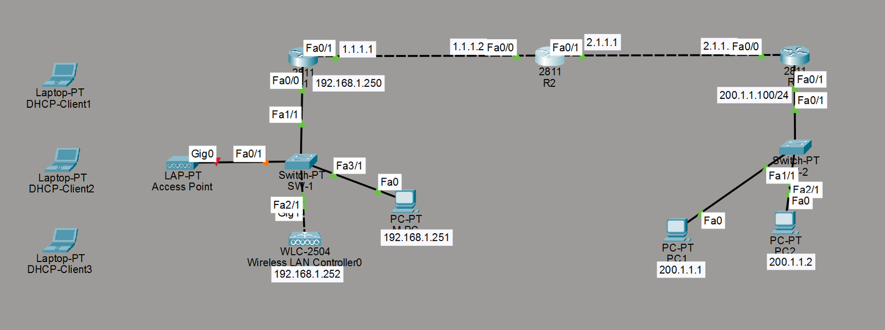
*Packet Tracer: routers R1/R2, a switch, WLC + access point with DHCP laptops, and PCs on `200.1.1.0/24`.*

### EVE-NG (on VMware Workstation)

EVE-NG runs real Cisco images, so it behaves like production gear. Steps:

1. Run the EVE-NG VM and install the **EVE client pack** on the host.
2. Upload images with **WinSCP** (login as `root`) into `/opt/unetlab/addons/`:
   - `qemu/` for Windows Server and firewall images (the folder must not contain a sub-folder)
   - `iol/` for Cisco IOL (L2 switch / L3 router images)
   - `dynamips/` for classic Dynamips routers

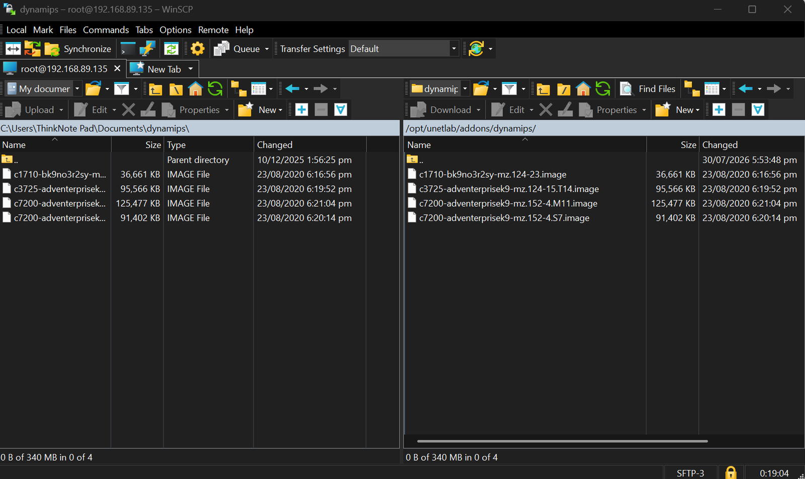
*Dynamips images (c1710, c3725, c7200) in `/opt/unetlab/addons/dynamips`.*

3. Fix image permissions, otherwise nodes won't start:

```bash
/opt/unetlab/wrappers/unl_wrapper -a fixpermissions
```

4. In the web UI add nodes (**right-click → Node → Cisco IOL**). I used an **L2 image** for switches and an **L3 image** for routers:

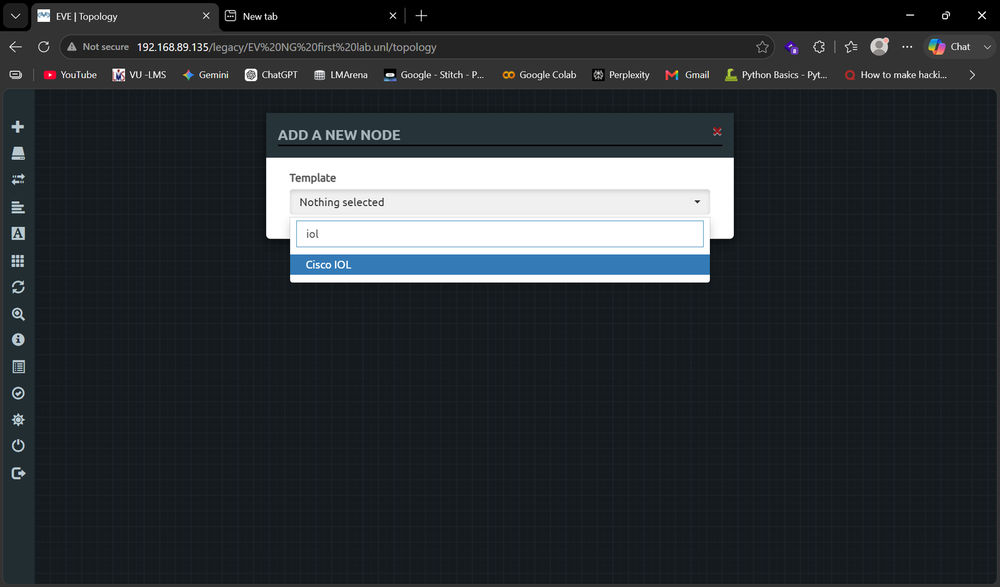

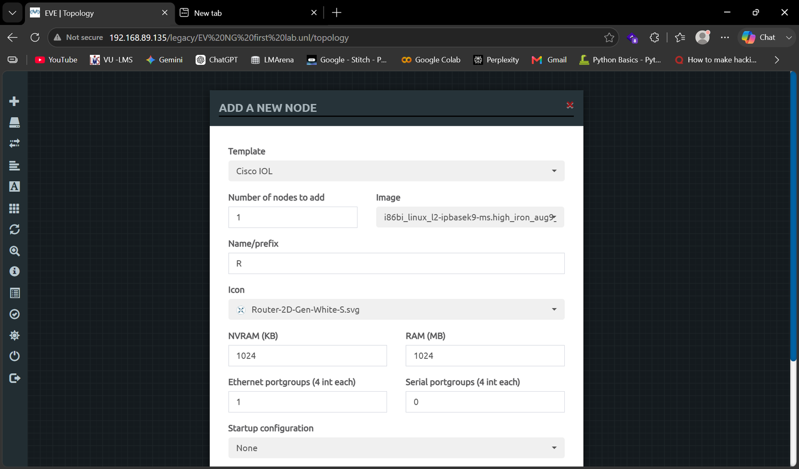
*L2 image `i86bi_linux_l2-ipbasek9…` used for switches.*


*L3 image `L3-ADVENTERPRISEK9-M-15.4-2T` used for routers.*

> Give nodes enough RAM and keep the host's own memory in mind (I give the EVE-NG VM 8 GB and each server node 4 GB).

### Connect EVE-NG to Kali with a Cloud

Attach a **Cloud** node (host-only `vmnet1`, `pnet1`) so the physical-lab Kali machine can reach the topology: `Kali → Cloud → Router → Switch → Server`.

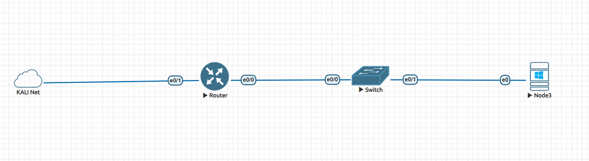

On the EVE-NG host, bind the bridge to a static address in `/etc/network/interfaces`:

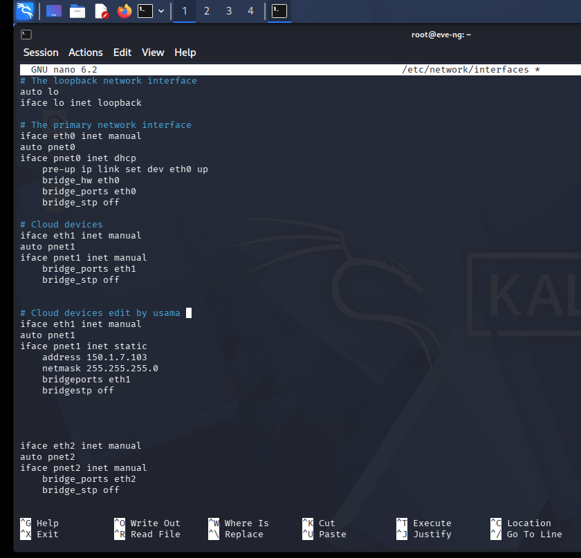

Address the router and add a default route:

```
interface ethernet 0/0
 ip address 150.1.7.103 255.255.255.0
 no shutdown
exit
ip route 0.0.0.0 0.0.0.0 150.1.7.100
```

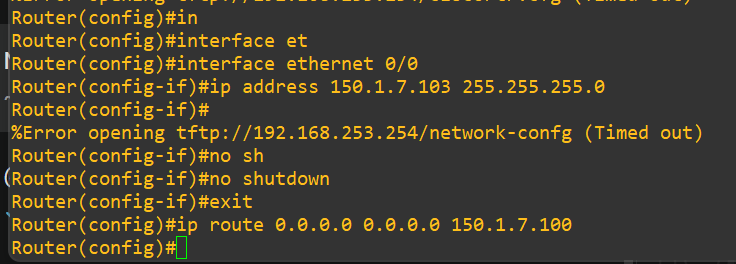
*The `%Error opening tftp://… network-confg (Timed out)` message is the router trying to auto-load a config over TFTP when the interface comes up. It's harmless.*

Test reachability:

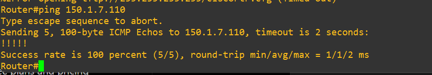

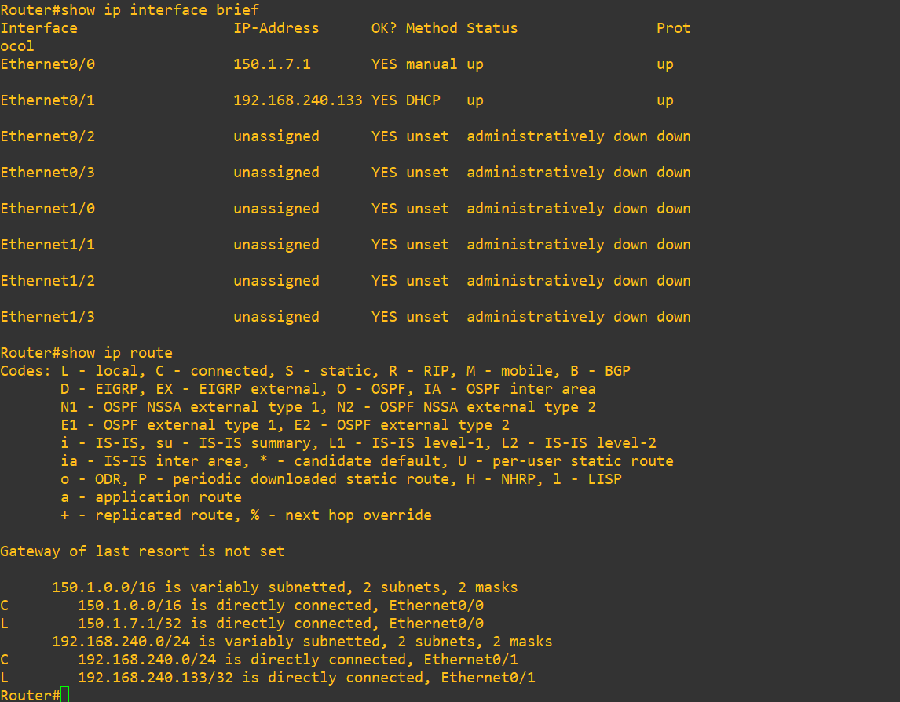
*One interface on the host-only network (`150.1.0.0/16`), one on NAT (`192.168.240.0/24`).*

---

## 2. Router basics

### IPv4 classes and private ranges (quick reference)

| Class | First octet | Default mask | Private range |
|---|---|---|---|
| A | 1–126 | /8 (255.0.0.0) | `10.0.0.0/8` |
| B | 128–191 | /16 | `172.16.0.0 – 172.31.255.255` |
| C | 192–223 | /24 | `192.168.0.0/16` |
| D / E | 224–239 / 240–255 | Multicast / experimental | none |

`127.0.0.0/8` is loopback and `0.0.0.0` is reserved. Private addresses are free to use inside a lab but are not routable on the internet, which is why **NAT** exists.

### Modes and memory

```
Router> enable                  ! user EXEC → privileged EXEC
Router# configure terminal      ! global configuration
Router(config)# interface fastEthernet 0/0
```

| Command | Shows |
|---|---|
| `show running-config` | Config in **RAM** (lost on reload) |
| `show startup-config` | Config in **NVRAM** (survives reboot) |
| `write` / `copy running-config startup-config` | Save RAM → NVRAM |

A router must have **different subnets on different interfaces**. You can't give two interfaces the same network.

### Passwords

```
hostname R1
line console 0
 password <console-pass>
 login
enable secret <strong-secret>      ! stored hashed; takes priority over "enable password"
service password-encryption
no ip domain-lookup                ! stops the CLI hanging on mistyped commands
```

---

## 3. DHCP server on a router

If the DHCP server dies, devices lose addressing, so large networks keep one or run a redundant pair. A router can act as a DHCP server (and then it's the clients' default gateway).

```
ip dhcp excluded-address 200.1.1.250 200.1.1.254     ! reserve addresses for infrastructure
ip dhcp pool Corvit
 network 200.1.1.0 255.255.255.0
 default-router 200.1.1.254
 dns-server 8.8.8.8
```

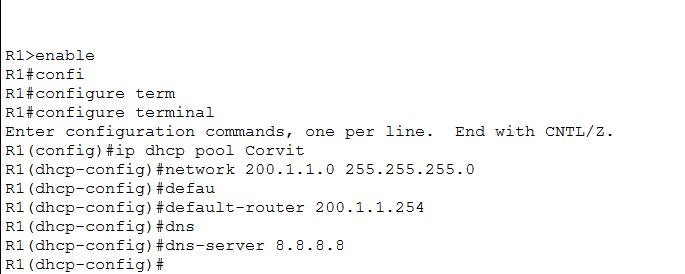

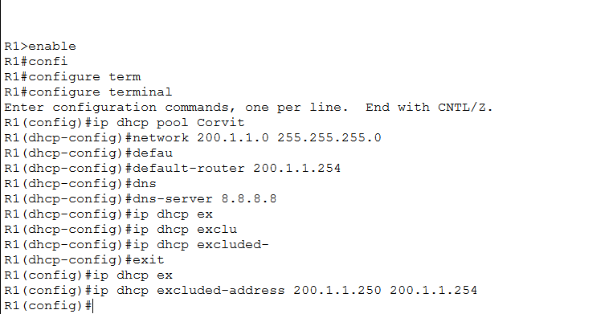
*Excluded range `200.1.1.250 – 200.1.1.254` added after the pool.*

Clients then use `ip address dhcp` on their interface. In my RIP screenshot below the router also logged `%DHCPD-4-PING_CONFLICT: DHCP address conflict: server pinged 200.1.1.1`. That means the server found the address already in use, so **exclude addresses that are statically assigned** before enabling the pool.

---

## 4. Static routing and RIP

### Static routes

```
ip route 200.1.1.0 255.255.255.0 1.1.1.2        ! network, mask, next hop
ip route 0.0.0.0 0.0.0.0 150.1.7.100            ! default route
show ip route
```

Think of it as: *"traffic for this network, with this mask, goes to this next-hop gateway."* The next hop must be a directly connected address.

### RIP v2

RIP advertises directly connected classful networks and is limited to **15 hops**:

```
router rip
 version 2
 no auto-summary
 network 12.0.0.0
 network 23.0.0.0
 network 200.0.0.0
 network 192.168.1.0
```

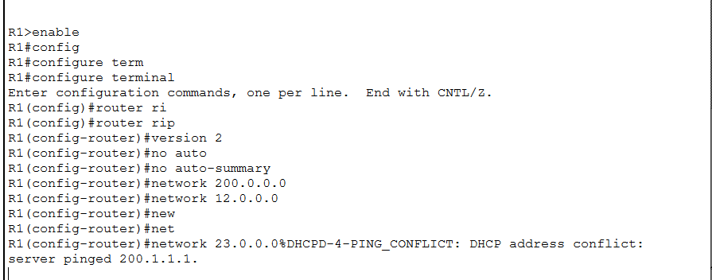

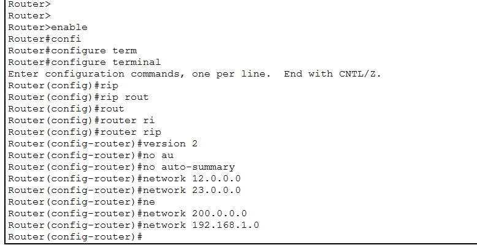

- `version 2` supports subnet masks (v1 is classful).
- `no auto-summary` stops RIP summarising to classful boundaries, which otherwise breaks discontiguous networks.
- Only use RIP authentication/hardening where RIP is the *only* protocol in the network.

---

## 5. NAT and ACLs

### ACL rules of thumb

| Type | Number range | Matches |
|---|---|---|
| Standard | 1–99 | Source address only |
| Extended | 100–199 | Source, destination, protocol, port |
| Named | any name | Either, easier to edit |

Use **wildcard masks** (the inverse of a subnet mask: `0.0.0.255` means "match the /24"). A standard ACL is applied close to the **destination**; an extended ACL close to the **source**. Every ACL ends with an implicit `deny any`.

```
! Standard: block one host, allow everyone else
access-list 1 deny 200.1.1.1 0.0.0.0
access-list 1 permit any
interface fastEthernet 0/0
 ip access-group 1 in

! Extended: block Telnet (TCP 23) from one host to one destination
access-list 111 deny tcp 200.1.1.2 0.0.0.0 1.1.1.1 0.0.0.0 eq 23
access-list 111 permit ip any any
interface fa0/0
 ip access-group 111 in
```

### NAT overload (PAT)

Translate the private LAN addresses to the router's outside interface:

```
interface fastEthernet 0/0
 ip nat outside
interface fastEthernet 0/1
 ip nat inside
interface fastEthernet 1/0
 ip nat inside

access-list 1 permit 192.168.1.0 0.0.0.255
access-list 1 permit 192.168.10.0 0.0.0.255
access-list 1 permit 192.168.20.0 0.0.0.255

ip nat inside source list 1 interface fastEthernet 0/0 overload
```

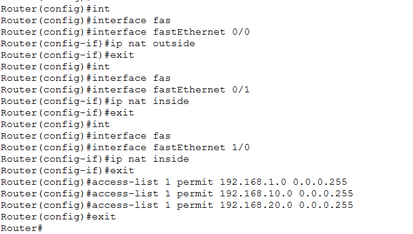
*Marking inside/outside interfaces and the permit list that selects which LANs get translated.*

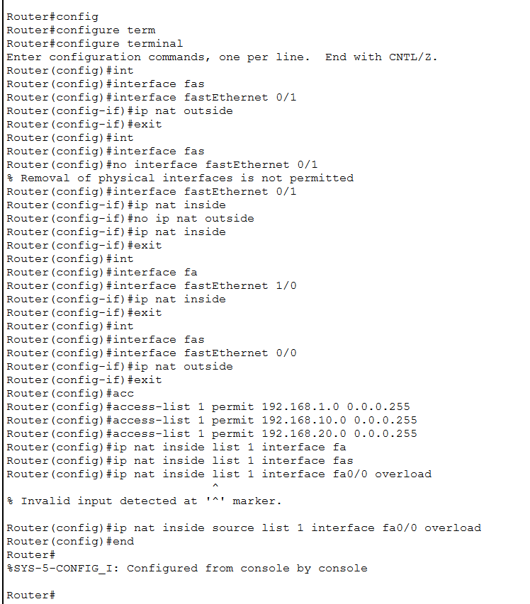
*My first attempt, `ip nat inside list 1 interface fa`, was rejected (`Invalid input detected at '^' marker`). The correct form is **`ip nat inside source list 1 interface fa0/0 overload`**, which was accepted.*

Verify with `show ip nat translations` and `show ip nat statistics`.

---

## 6. VLANs, trunking and inter-VLAN routing

VLANs split one physical switch into separate broadcast domains: segmentation for security and performance.

| VLAN | Name | Access ports |
|---|---|---|
| 10 | HR | fa0/1 – 2 |
| 20 | Admin | fa0/3 – 4 |
| 30 | Guest | fa0/5 – 6 |

```
vlan 10
 name HR
vlan 20
 name Admin
vlan 30
 name Guest
exit
interface range fa0/1 - 2
 switchport mode access
 switchport access vlan 10
 no shutdown
interface range fa0/3 - 4
 switchport mode access
 switchport access vlan 20
interface range fa0/5 - 6
 switchport mode access
 switchport access vlan 30
show vlan brief
show interfaces status
```

### Trunks between switches

A **trunk** carries multiple VLANs over one link (802.1Q tagging).

```
interface fastEthernet 0/1
 switchport trunk encapsulation dot1q
 switchport mode trunk
 switchport trunk allowed vlan 1,10,20,30
 no shutdown
show interfaces trunk
```

> Create the **same VLANs on every switch**, but give the management/SVI IP to only one of them per VLAN.

### Inter-VLAN routing with a Layer-3 switch (SVIs)

```
ip routing                              ! turns the switch into a Layer 3 device
interface vlan 10
 ip address 10.1.1.100 255.0.0.0
interface vlan 20
 ip address 20.1.1.100 255.0.0.0
show ip route
```

A routed port uses `no switchport` plus an IP address. Alternatively use **router-on-a-stick**: one trunk to a router with sub-interfaces.

---

## 7. Switch security: port security, PortFast, VTP

### Port security

Limit which devices can use a port and shut it down on violation:

```
interface fastEthernet 0/1
 switchport mode access
 switchport port-security
 switchport port-security maximum 1
 switchport port-security violation shutdown
 switchport port-security mac-address sticky      ! learn the first MAC automatically
 no shutdown
show port-security interface fa0/1
```

If a violation puts the port in `err-disabled`, fix the cause, then `shutdown` / `no shutdown` the interface.

### PortFast

Skips the STP listening/learning delay on **access ports only** (hosts, never switches):

```
interface range fa0/1 - 2
 spanning-tree portfast
```

### VTP

VLAN Trunking Protocol copies the VLAN database between switches in the same domain, so the switches must share the domain and use the highest revision as the source of truth. Check with `show vtp status`. Be careful: a switch with a higher revision number and a blank database can overwrite your VLANs.

---

## 8. STP and RSTP

STP prevents Layer-2 loops. Every STP network needs:

- **one root bridge** (lowest bridge ID = priority + MAC wins),
- **one designated port per segment** (the port sending the best BPDU),
- **one root port per non-root bridge** (the port receiving the best BPDU).

The **lowest value wins** in every BPDU comparison. Classic STP is slow to converge when a root port dies, so I switched to **Rapid PVST+**:

```
spanning-tree mode rapid-pvst
```

### Choose the root bridge and load-balance by VLAN

```
! Switch A: root for VLANs 1 and 10
spanning-tree vlan 1,10 priority 24576
! Switch B: root for VLANs 20 and 30
spanning-tree vlan 20,30 priority 24576

! Steer traffic with port priority or cost (lower = preferred)
interface fa0/2
 spanning-tree vlan 20 port-priority 16
interface fa0/2
 spanning-tree vlan 10 cost 15
```

Verify: `show spanning-tree`, `show spanning-tree vlan 10`, `show interfaces trunk`.

Splitting roots by VLAN means both uplinks carry traffic instead of one sitting idle in the blocking state.

---

## 9. EtherChannel

EtherChannel bundles several physical links into **one logical link** (more bandwidth, and it still works if one cable fails, with STP treating it as a single link).

| Protocol | Standard | Modes that form a channel |
|---|---|---|
| **PAgP** | Cisco proprietary | `desirable`↔`desirable`, `desirable`↔`auto` (not `auto`↔`auto`) |
| **LACP** | IEEE 802.3ad | `active`↔`active`, `active`↔`passive` (not `passive`↔`passive`) |
| Static | none | `on`↔`on` |

```
interface range fa0/1 - 2
 channel-group 1 mode active          ! LACP; use desirable for PAgP, on for static
show etherchannel summary
```

Layer-3 channel between two L3 switches:

```
ip routing
interface port-channel 1
 no switchport
 ip address 1.1.1.1 255.0.0.0
```

---

## 10. HSRP (first-hop redundancy)

HSRP (like VRRP and GLBP) gives clients a **virtual gateway IP** that survives a router failure. Both routers share the virtual IP; the higher priority (default **100**) becomes **Active**, the other **Standby**.

```
! Router 1 (will be Active)
interface fastEthernet 1/0
 standby 1 ip 200.1.1.250
 standby 1 priority 100
 standby 1 preempt

! Router 2: same virtual IP, lower priority
interface fastEthernet 1/0
 standby 1 ip 200.1.1.250
 standby 1 priority 50
 standby 1 preempt

show standby
```

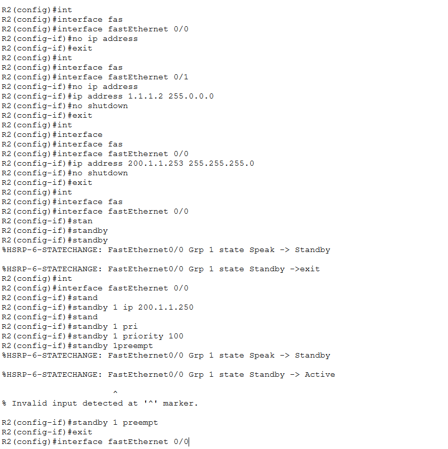
*The log shows the state machine: `Speak -> Standby`, then `Standby -> Active` once the other router goes away.*

Clients use `200.1.1.250` as their default gateway. To test: shut the active router's interface, so the standby takes over (`preempt` lets the higher-priority router reclaim the role when it returns).

---

## 11. OSPF

OSPF is a link-state protocol with fast convergence, hierarchical **areas**, and **Hello 10 s / Dead 40 s** timers. Both neighbours must agree on area ID, and the router ID comes from a manual `router-id`, else the highest loopback, else the highest interface IP.

### Single area

```
router ospf 1
 router-id 11.1.1.1
 network 1.0.0.0 0.255.255.255 area 1
 network 22.0.0.0 0.255.255.255 area 1
```

Verify: `show ip protocols`, `show ip ospf neighbor`, `show ip ospf interface fa0/0`, `show ip ospf database`, `show ip route ospf`.

### Multi-area design

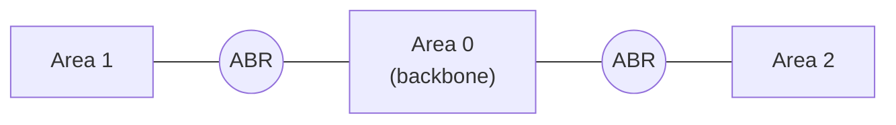

**Area 0 is the backbone** and every other area must connect to it. A router with interfaces in two areas is an **ABR** (Area Border Router); a router that injects external routes is an **ASBR**.

My chain of routers R13 – R14 – R15 – R16:

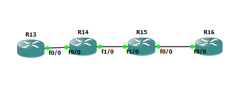

The routing table on **R2** shows several route types in one network:

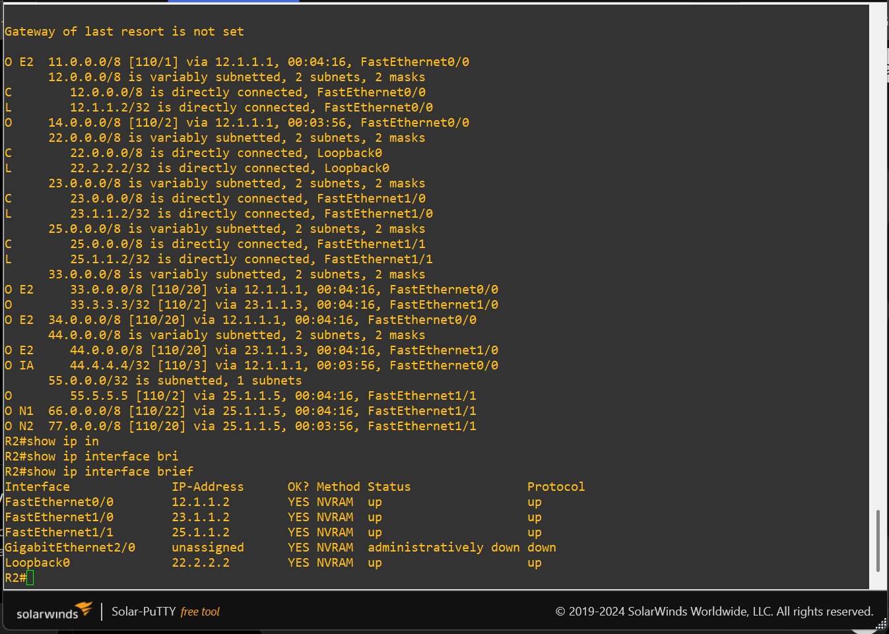

| Code | Meaning |
|---|---|
| `O` | Intra-area route |
| `O IA` | **Inter-area** route (learned across an ABR) |
| `O E2` | **External type 2** (redistributed; metric doesn't grow inside OSPF) |
| `O N1` / `O N2` | **NSSA** external routes |

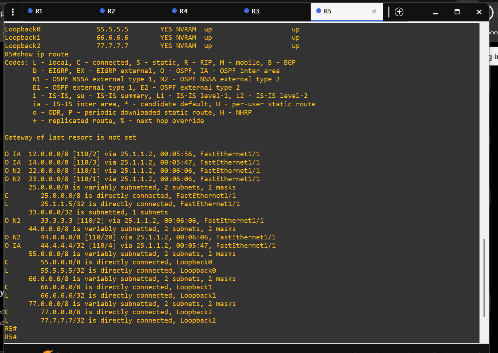

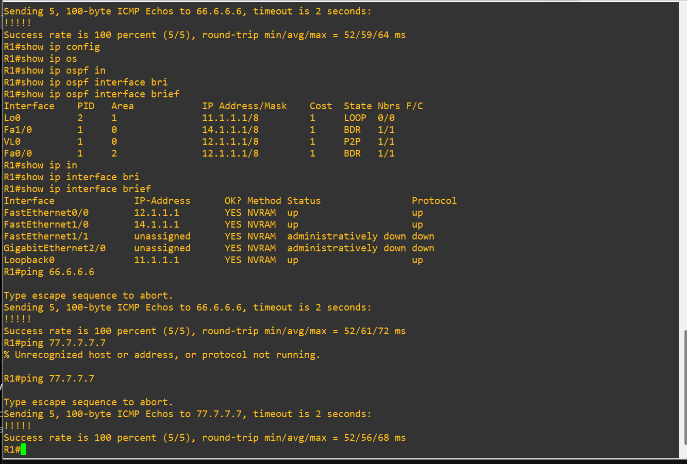
*`show ip ospf interface brief` on R1: interfaces in different areas, a loopback, and a **virtual link** (`VL0`).*

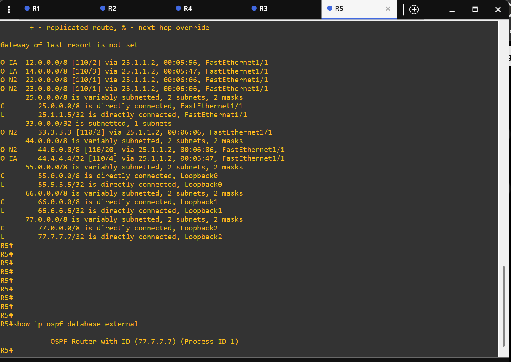
*`show ip ospf database external` on R5 (router ID `77.7.7.7`) lists the external LSAs.*

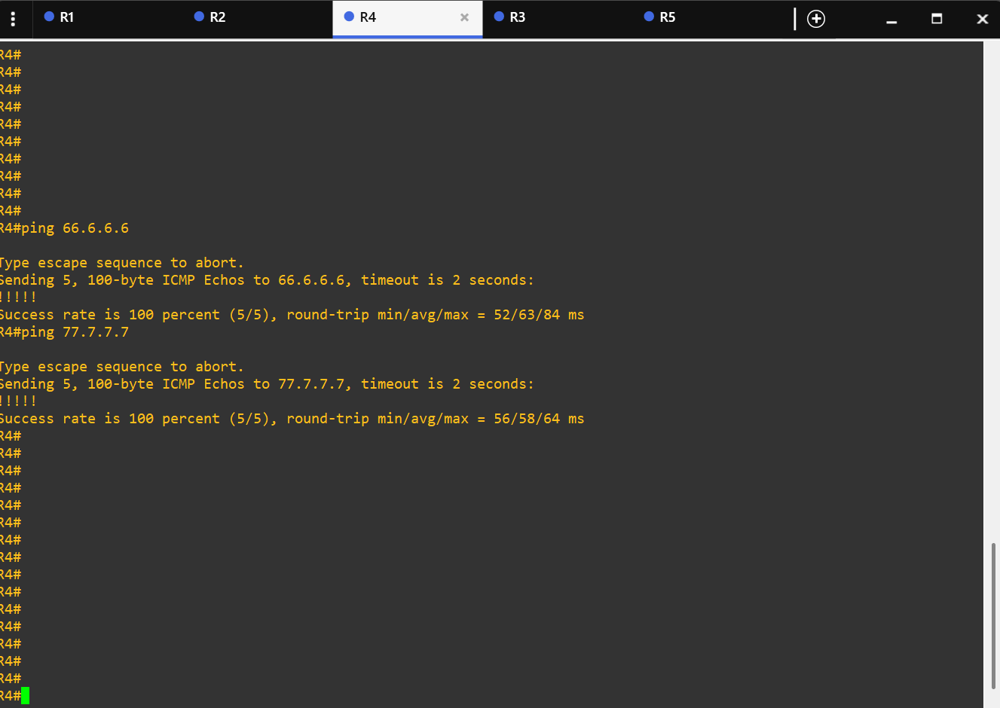
*End-to-end pings to the loopbacks `66.6.6.6` and `77.7.7.7` across all areas: 100% success.*

### Special area types and tools

```
! Stub area: blocks external (type-5) LSAs. Configure on EVERY router in the area
router ospf 1
 area 1 stub
! Totally stubby: also blocks inter-area routes; the ABR adds "no-summary"
 area 1 stub no-summary
! NSSA: allows a limited ASBR inside a stub-like area (gives O N1/O N2 routes)
 area 1 nssa

! Virtual link: temporarily connect a disconnected area to area 0 through a transit area
 area 2 virtual-link 22.2.2.2

! Redistribution between protocols
router ospf 1
 redistribute rip subnets
router rip
 redistribute ospf 1 metric 1
```

A GRE **tunnel** can also carry OSPF between routers when there is no direct link: give each end a tunnel IP (`interface tunnel 1`) and advertise it with `network 200.1.1.1 0.0.0.0 area 0`.

After changing OSPF settings, `clear ip ospf process` restarts adjacencies. Debug with `debug ip ospf adj` / `debug ip ospf events` (and turn it off afterwards).

---

## 12. Access hardening and SSH

Telnet sends everything, **including passwords, in clear text** (I confirmed this in Wireshark in an earlier lab: user and password were readable), so management should use **SSH**:

```
hostname R1
ip domain-name lab.local
crypto key generate rsa modulus 2048
ip ssh version 2
username admin privilege 15 secret <strong-password>

line vty 0 4
 login local
 transport input ssh
 exec-timeout 10 0
```

Further hardening I practised:

- `enable secret` instead of `enable password`, plus `service password-encryption`
- a **standard ACL on the VTY lines** so only the admin subnet can log in:
  `access-class 10 in` after `access-list 10 permit 150.1.7.0 0.0.0.255`
- **port security** and **shutdown of unused ports** on switches
- **VLAN segmentation** (a separate guest VLAN) and **ACLs** between zones
- `no ip http server` once finished with the web interface

---

## 13. Verification and troubleshooting commands

| Goal | Command |
|---|---|
| Interface state | `show ip interface brief` |
| Routing table | `show ip route` |
| DHCP leases / conflicts | `show ip dhcp binding`, `show ip dhcp conflict` |
| VLANs / trunks | `show vlan brief`, `show interfaces trunk` |
| STP | `show spanning-tree [vlan N]` |
| EtherChannel | `show etherchannel summary` |
| HSRP | `show standby brief` |
| OSPF | `show ip ospf neighbor`, `show ip ospf database` |
| ACLs / NAT | `show access-lists`, `show ip nat translations` |
| Config | `show running-config \| section ospf` |

If a command is rejected (`Invalid input detected at '^' marker`), the caret points at the mistake. Use `?` after any word to list valid options.

---

## 14. Lessons learned

- **Design first, then configure.** Draw the topology and address plan before typing commands.
- **Verify every layer:** interface up → addressing → neighbour → route → end-to-end ping.
- **Redundancy needs testing.** HSRP and RSTP only prove themselves when you pull a cable.
- **Segment by default** (VLANs + ACLs) and **harden management access** (SSH, secrets, port security).
- **Read the router's error messages**: the `^` marker, DHCP conflict logs and OSPF state changes tell you exactly what's wrong.

---

*Built in an isolated virtual lab (EVE-NG and Packet Tracer) for learning and portfolio purposes.*

[Browse more of my work on GitHub ↗](https://github.com/UsamaAhmad360?tab=repositories)
